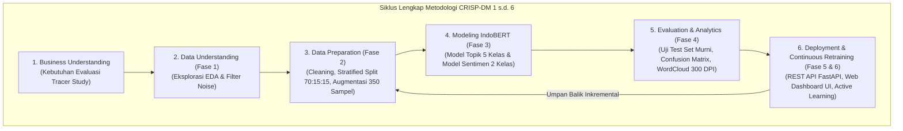

# 🎓 Sistem NLP Tracer Study Berbasis Dual-Model IndoBERT & Continuous Retraining
## Universitas Dinamika — Standar Metodologi CRISP-DM (*Cross-Industry Standard Process for Data Mining*)

Repositori proyek Praktik Kerja Lapangan (PKL) / Magang untuk automasi klasifikasi topik masukan dan analisis sentimen testimoni alumni Universitas Dinamika berbasis **Dual-Model IndoBERT Transformer (110 Juta Parameter)** dan arsitektur pembelajaran berkelanjutan (*Continuous Retraining & Active Learning*).

---

## 📌 Metodologi & Arsitektur End-to-End (CRISP-DM 1 - 6)



### 🎯 Spesifikasi Model & Fitur Utama:
1. **Model 1 (Topik Kritik/Saran):** IndoBERT Base (`indobenchmark/indobert-base-p1`) $\rightarrow$ **5 Kelas Topik**:
   * `0`: Kurikulum & Pembelajaran
   * `1`: Fasilitas & Sarana Prasarana
   * `2`: Dosen & Tenaga Pengajar
   * `3`: Karier, Magang & Kesiapan Kerja
   * `4`: Layanan Kemahasiswaan & Administrasi Kampus
2. **Model 2 (Sentimen Testimoni):** IndoBERT Base (`indobenchmark/indobert-base-p1`) $\rightarrow$ **2 Kelas Sentimen** (`0: Negatif`, `1: Positif`).
3. **Data Augmentation:** *Back-Translation* & *Contextual Synonym Paraphrasing* menghasilkan 350 sampel seimbang per model.
4. **Anti-Data Leakage Evaluation:** Evaluasi murni pada *Test Set 15%* asli tanpa data augmentasi, dilengkapi *Heatmap Confusion Matrix* dan analisis kata kunci *WordCloud*.
5. **Serving Layer REST API:** FastAPI & Uvicorn asynchronous server berkecepatan tinggi ($< 50\text{ ms}$ per inferensi).
6. **Interactive Web Dashboard UI:** Aplikasi modern satu halaman (*Single Page Application*) dengan tema Glassmorphism Universitas Dinamika (Live Studio, Batch File Processor, Analitik Kata Kunci, dan Human-in-the-Loop Center).
7. **Active Learning & Continuous Retraining:** Otomasi penandaan masukan ambigu ($\text{Confidence} < 70\%$), antarmuka verifikasi manusia, dan pelatih ulang model dengan proteksi *Anti-Regression Guard* & *Auto-Rollback*.

---

## 📁 Struktur Direktori Proyek

```text
├── data/
│   ├── raw/                              # Data hasil ekstraksi XLSX (EDA)
│   ├── processed/                        # Data Stratified Split Murni (Train 70%, Val 15%, Test 15%)
│   ├── augmented/                        # Data Latih Hasil Augmentasi (350 Sampel Seimbang)
│   └── active_learning/                  # Buffer Antrean Review & Dataset Terverifikasi
├── docs/
│   ├── DOKUMENTASI_FASE_1_DAN_2.md       # Laporan EDA, Preprocessing, & Data Augmentation
│   ├── DOKUMENTASI_FASE_3_DAN_4.md       # Laporan Modeling IndoBERT & Evaluasi Test Set
│   └── DOKUMENTASI_FASE_5_DAN_6.md       # Laporan Deployment, REST API, Web UI & Retraining
├── models/
│   ├── topic_model/                      # Checkpoint Produksi Model Topik & Tokenizer
│   ├── sentiment_model/                  # Checkpoint Produksi Model Sentimen & Tokenizer
│   └── backups/                          # Arsip Checkpoint Historis (Safety Rollback)
├── notebooks/
│   ├── 01_crisp_dm_eda_preprocessing_augmentation.ipynb # Notebook EDA & Data Preparation
│   ├── 02_crisp_dm_modeling_evaluation.ipynb            # Notebook Modeling IndoBERT & Evaluasi
│   └── 03_crisp_dm_deployment_retraining.ipynb         # Notebook Deployment API & Retraining
├── reports/
│   ├── figures/                          # Kurva Pelatihan, Confusion Matrix, & Performa Per-Kelas
│   ├── wordclouds/                       # Gambar WordCloud Analitik Kata Kunci (300 DPI)
│   ├── annotated_uploads/                # File Excel/CSV Beranotasi Hasil Batch
│   └── metrics_summary.json              # Rekapitulasi Metrik Evaluasi Terkini
├── scripts/
│   ├── eda_summary.py                    # Analisis Statistik & Eksplorasi Data
│   ├── train_models.py                   # Orchestrator Pelatihan Awal Model
│   ├── evaluate_models.py                # Orchestrator Evaluasi Test Set & Plotting
│   ├── retrain_pipeline.py               # Skrip Eksekusi Continuous Retraining CLI
│   ├── run_server.py                     # Skrip Peluncur Server FastAPI & Web UI
│   ├── generate_notebook.py              # Generator Colab Notebook 1
│   ├── generate_notebook_modeling.py     # Generator Colab Notebook 2
│   └── generate_notebook_deployment.py   # Generator Colab Notebook 3
├── src/
│   ├── preprocessing.py                  # Text cleaning & kamus slang Tracer Study
│   ├── split_data.py                     # Stratified 70:15:15 data splitter (Anti-Leakage)
│   ├── data_augmentation.py              # Engine Back-Translation & Paraphrasing
│   ├── dataset.py                        # PyTorch Dataset & DataLoader IndoBERT
│   ├── model.py                          # Arsitektur & Factory IndoBERT Sequence Classification
│   ├── train.py                          # Training Loop Engine (AdamW, Warmup, Early Stopping)
│   ├── evaluate.py                       # Evaluation Engine (Accuracy, Macro F1, Reports)
│   ├── visualize.py                      # Generator Heatmap Confusion Matrix & WordCloud
│   ├── predict.py                        # Pipeline Inferensi Terpadu & Active Learning Flag
│   ├── api.py                            # REST API Serving Layer FastAPI & Endpoints
│   ├── server.py                         # ASGI Server Configuration & Lifespan
│   ├── continuous_retraining.py          # Continuous Retraining & Anti-Regression Engine
│   └── static/                           # Web Dashboard UI Assets
│       ├── index.html                    # Single Page Application HTML5
│       ├── style.css                     # Glassmorphism Stylesheet
│       └── app.js                        # Client-Side Interactivity & API Logic
├── hasil_clustering.xlsx                 # Dataset Mentah Tracer Study Universitas Dinamika
├── requirements.txt                      # Daftar Dependensi Python
└── README.md                             # Dokumentasi Ringkas Repositori
```

---

## 🚀 Panduan Eksekusi Lengkap

### 1. Menjalankan REST API & Web Dashboard UI (Rekomendasi Utama)
```bash
python scripts/run_server.py --host 127.0.0.1 --port 8000
```
Buka peramban (browser):
* **Web Dashboard Interaktif:** [http://localhost:8000/](http://localhost:8000/)
* **Dokumentasi Interaktif Swagger API:** [http://localhost:8000/docs](http://localhost:8000/docs)
* **Dokumentasi ReDoc:** [http://localhost:8000/redoc](http://localhost:8000/redoc)

---

### 2. Menjalankan Tahapan CRISP-DM per Modul (CLI)

#### Tahap 1 & 2: Data Understanding & Data Preparation
```bash
# 1. Ekstraksi EDA & statistik deskriptif
python scripts/eda_summary.py

# 2. Pembagian dataset terstratifikasi (70:15:15)
python src/split_data.py

# 3. Augmentasi data latih (Back-Translation & Paraphrase menjadi 350 sampel)
python src/data_augmentation.py
```

#### Tahap 3: Fine-Tuning Dual-Model IndoBERT (Modeling)
```bash
python scripts/train_models.py
```

#### Tahap 4: Evaluasi Test Set & Visualisasi Analitik (Evaluation)
```bash
python scripts/evaluate_models.py
```

#### Tahap 5 & 6: Continuous Retraining & Active Learning Feedback Loop
```bash
python scripts/retrain_pipeline.py
```

---

### 3. Menjalankan di Google Colab (Akselerasi GPU Gratis)
Repositori ini menyediakan trilogi notebook interaktif yang siap dijalankan di Google Colab:
1. **Notebook 1 (EDA & Data Preparation):** [notebooks/01_crisp_dm_eda_preprocessing_augmentation.ipynb](notebooks/01_crisp_dm_eda_preprocessing_augmentation.ipynb)
2. **Notebook 2 (Modeling & Evaluasi):** [notebooks/02_crisp_dm_modeling_evaluation.ipynb](notebooks/02_crisp_dm_modeling_evaluation.ipynb)
3. **Notebook 3 (Deployment & Continuous Retraining):** [notebooks/03_crisp_dm_deployment_retraining.ipynb](notebooks/03_crisp_dm_deployment_retraining.ipynb)

---

## 📘 Dokumentasi Lengkap untuk Laporan PKL/Magang
Dokumentasi akademik terperinci yang mencakup teori, metodologi, rumus matematis, tabel metrik, dan pembahasan hasil telah disusun rapi di folder `docs/`:
- [docs/DOKUMENTASI_FASE_1_DAN_2.md](file:///run/media/wezz/New%20Volume/magang/machine%20learning/docs/DOKUMENTASI_FASE_1_DAN_2.md): Landasan teori CRISP-DM 1, 2, 3 untuk **BAB III (Metodologi)**.
- [docs/DOKUMENTASI_FASE_3_DAN_4.md](file:///run/media/wezz/New%20Volume/magang/machine%20learning/docs/DOKUMENTASI_FASE_3_DAN_4.md): Arsitektur Transformer IndoBERT & evaluasi test set untuk **BAB IV (Hasil dan Pembahasan)**.
- [docs/DOKUMENTASI_FASE_5_DAN_6.md](file:///run/media/wezz/New%20Volume/magang/machine%20learning/docs/DOKUMENTASI_FASE_5_DAN_6.md): Serving REST API, Web UI, Active Learning & Continuous Retraining untuk **BAB IV (Subbab Serving) & BAB V (Kesimpulan & Saran)**.
