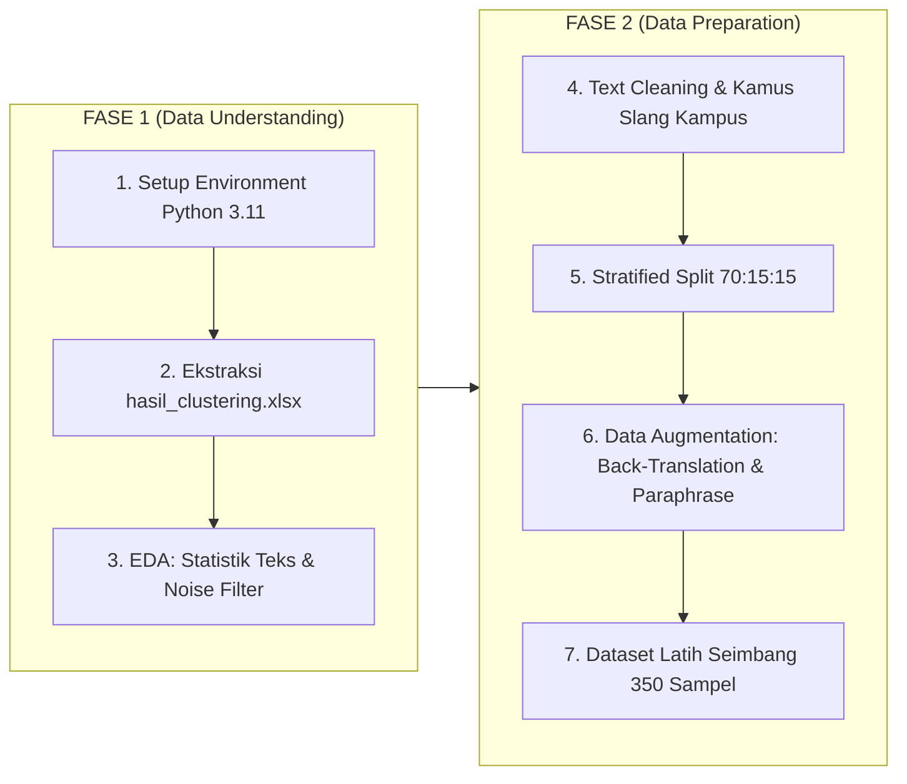

# 📘 DOKUMENTASI LENGKAP: FASE 1 & FASE 2 SISTEM NLP TRACER STUDY INDOBERT
## Standar Metodologi CRISP-DM untuk Laporan Praktik Kerja Lapangan (PKL) / Magang

**Penulis / Pengembang:** Tim Magang NLP Tracer Study  
**Institusi:** Universitas Dinamika  
**Model Backbone:** IndoBERT Base (`indobenchmark/indobert-base-p1` - 110 Juta Parameter)  
**Dataset Input:** `hasil_clustering.xlsx` (Data Kuesioner Kritik, Saran, & Testimoni Alumni)

---

## 📑 DAFTAR ISI
1. [Ringkasan Eksekutif & Metodologi CRISP-DM](#1-ringkasan-eksekutif--metodologi-crisp-dm)
2. [Fase 1: Setup Environment & Dependensi (CRISP-DM: Environment Setup)](#2-fase-1-setup-environment--dependensi)
3. [Fase 1: Exploratory Data Analysis / EDA (CRISP-DM: Data Understanding)](#3-fase-1-exploratory-data-analysis--eda)
4. [Fase 2: Preprocessing Pipeline Khusus IndoBERT (CRISP-DM: Data Preparation)](#4-fase-2-preprocessing-pipeline-khusus-indobert)
5. [Fase 2: Stratified Data Splitting & Anti-Data Leakage (CRISP-DM: Data Preparation)](#5-fase-2-stratified-data-splitting--anti-data-leakage)
6. [Fase 2: Data Augmentation Engine (CRISP-DM: Data Preparation)](#6-fase-2-data-augmentation-engine)
7. [Struktur File & Direktori yang Terbentuk](#7-struktur-file--direktori-yang-terbentuk)
8. [Panduan Menjalankan Notebook Google Colab](#8-panduan-menjalankan-notebook-google-colab)
9. [Panduan Integrasi ke Bab Laporan PKL](#9-panduan-integrasi-ke-bab-laporan-pkl)

---

## 1. Ringkasan Eksekutif & Metodologi CRISP-DM

Proyek ini bertujuan untuk membangun sistem cerdas klasifikasi teks umpan balik alumni (*Tracer Study*) menggunakan model NLP Transformer **IndoBERT**. Seluruh alur kerja dirancang menggunakan standar industri **CRISP-DM (*Cross-Industry Standard Process for Data Mining*)**:



---

## 2. Fase 1: Setup Environment & Dependensi

### 2.1 Mengapa Python 3.11.16 & Toolchain Mandiri?
* **Stabilitas Ekosistem AI:** Framework Deep Learning (`torch 2.13`, `transformers 5.16`, `accelerate`) membutuhkan runtime CPython yang kompatibel tanpa konflik pustaka C++/CUDA.
* **Isolasi Virtual Environment (`mise` / `venv`):** Menjamin bahwa pustaka machine learning terisolasi rapi, tidak merusak aplikasi global Linux, dan dapat diulang (*reproducible*) di laptop dosen atau server kampus.

### 2.2 Daftar Dependensi Inti (`requirements.txt`)
* `torch` & `transformers`: Framework tensor graf dan arsitektur model IndoBERT pre-trained.
* `datasets` & `evaluate`: Pustaka evaluasi metrik NLP standar Hugging Face (Macro F1, Precision, Recall).
* `accelerate`: Manajemen alokasi memori CPU/GPU saat pelatihan dan inferensi.
* `pandas` & `openpyxl`: Engine manipulasi data tabular dan pembaca format Excel `.xlsx`.
* `scikit-learn`: Stratified sampling, pembobotan kelas, dan matriks konfusi.
* `deep-translator`: Engine *Back-Translation* berbasis Google Translate API.
* `matplotlib`, `seaborn`, `wordcloud`: Visualisasi grafik distribusi statistik dan visual kata kunci.
* `fastapi` & `uvicorn`: Serving layer REST API asynchronous performa tinggi.

---

## 3. Fase 1: Exploratory Data Analysis / EDA (Data Understanding)

### 3.1 Profiling Dataset Awal (`hasil_clustering.xlsx`)
Dataset yang diunggah terdiri atas 3 sheet kuesioner utama:
* Sheet **`Kritik`**: 57 baris data masukan alumni.
* Sheet **`Saran`**: 60 baris data usulan alumni.
* Sheet **`Testimoni`**: 64 baris data pengalaman alumni.
* Sheet **`Keywords per Cluster`**: 90 kata kunci pembobot cluster awal.

### 3.2 Eksekusi Skrip EDA (`scripts/eda_summary.py`)
Skrip `scripts/eda_summary.py` dijalankan untuk mengekstrak data mentah, menghitung statistik panjang kalimat, dan mendeteksi data *noise*.

#### Hasil Analisis Statistik Teks Riil:
| Sheet | Total Data | Data Valid | Data Noise Disaring | Rata-rata Kata | Rata-rata Karakter | Top Program Studi |
| :--- | :---: | :---: | :---: | :---: | :---: | :--- |
| **`Kritik`** | 57 | **55** | 2 | 19.87 kata | 144.76 karakter | Sistem Informasi (26), DKV (13), Desain Produk (5) |
| **`Saran`** | 60 | **59** | 1 | 20.83 kata | 155.47 karakter | Sistem Informasi (29), DKV (12), Manajemen (7) |
| **`Testimoni`** | 64 | **64** | 0 | 23.98 kata | 175.44 karakter | Sistem Informasi (35), DKV (12), Manajemen (10) |
| **Total Gabungan** | **181** | **178** | **3** | **21.56 kata** | **158.55 karakter** | **Dataset Gabungan Bersih: 178 Sampel** |

#### Temuan Kritis EDA:
1. **Keberadaan Data Noise:** Ditemukan 3 data non-kontributif seperti `"No komen nice"` dan `"emm tidak ada"` yang berhasil disaring agar tidak merusak kualitas training model.
2. **Karakteristik Gaya Bahasa Alumni:** Menggunakan campuran bahasa semi-formal, istilah akademik, singkatan gaul/slang (`undika`, `loker`, `dosen2`, `bgt`, `ga/gak`, `klo`), dan istilah serapan bahasa Inggris (*"softskill"*, *"hardskill"*, *"match"*, *"deadline"*).
3. **Regime Few-Shot Learning:** Total data unik (~117 data kritik & saran, 64 testimoni) tergolong sedikit untuk melatih model Transformer 110M parameter, sehingga mutlak membutuhkan strategi augmentasi data terarah.

---

## 4. Fase 2: Preprocessing Pipeline Khusus IndoBERT (Data Preparation)

### 4.1 Landasan Teori: Mengapa BERT TIDAK BOLEH Di-Stemming / Dihapus Stopwords Agresif?
Pada metode konvensional (TF-IDF, Naive Bayes), *stemming* dan penghapusan *stopwords* adalah hal wajib. Namun pada **Transformer (BERT)**, hal tersebut **dilarang keras** karena:
1. **Mekanisme Self-Attention & Positional Encoding:** BERT memahami makna sebuah kata dari urutan dan konteks kalimat utuh.
2. **Peran Kritis Stopwords:** Kata seperti *"tidak"*, *"kurang"*, *"belum"* menentukan sentimen. Menghapus kata *"tidak"* pada *"fasilitas lab tidak memadai"* akan membalik makna menjadi positif secara fatal.
3. **WordPiece Tokenizer:** IndoBERT sudah memecah kata menjadi unit subword morfem secara otomatis (misal: `peningkatan` $\rightarrow$ `pen`, `##ingkatan`).

### 4.2 Alur Pembersihan Teks (`src/preprocessing.py`)
Modul `src/preprocessing.py` menerapkan 5 langkah pembersihan:
1. **Case Folding Terkendali:** Konversi teks ke huruf kecil (*lowercase*).
2. **Pembersihan Noise & Simbol:** Menghapus tag HTML/URL dan merapikan tanda baca berulang (misal `???` $\rightarrow$ `?`, `!!!` $\rightarrow$ `!`).
3. **Normalisasi Slang & Istilah Kampus:**
   * `undika` $\rightarrow$ `universitas dinamika`
   * `loker` $\rightarrow$ `lowongan kerja`
   * `dosen2` / `dosendosen` $\rightarrow$ `dosen-dosen`
   * `bgt` / `bngt` $\rightarrow$ `sangat`
   * `ga` / `gak` / `tdk` $\rightarrow$ `tidak`
   * `klo` / `kalo` $\rightarrow$ `kalau`
   * `softskill` $\rightarrow$ `keterampilan interpersonal`
   * `hardskill` $\rightarrow$ `keterampilan teknis`
   * `praktek` $\rightarrow$ `praktik`
   * `magang` $\rightarrow$ `magang`
   * `match` $\rightarrow$ `sesuai`
4. **Penyaringan Noise Otomatis:** Fungsi `is_noise_text()` membuang teks hampa makna.

#### Contoh Uji Coba Preprocessing:
* **Teks Asli:** `"Perlu peningkatan fasilitas lab komputer, loker magang diperbanyak bgt!!"`
* **Teks Bersih:** `"perlu peningkatan fasilitas lab komputer, lowongan kerja magang diperbanyak sangat!"`

---

## 5. Fase 2: Stratified Data Splitting & Anti-Data Leakage

### 5.1 Aturan Emas Evaluasi Machine Learning (*No Data Leakage*)
```
Dataset Asli Bersih (178 Sampel)
        │
        ├── Stratified Split (70% Train, 15% Val, 15% Test)
        │
        ├── Train Set Asli (~79 Sampel)  ──>  [Data Augmentation Engine]  ──>  Train Set Akhir (350 Sampel Seimbang)
        │
        ├── Val Set Asli   (~17 Sampel)  ──>  [Evaluasi Checkpoint Saat Training - MURNI DATA ASLI]
        │
        └── Test Set Asli  (~18 Sampel)  ──>  [Evaluasi Akhir Kinerja Model - MURNI DATA ASLI]
```
> ⚠️ **Prinsip Kritis:** Augmentasi data **HANYA diterapkan pada Train Set**. Data Val dan Test harus 100% murni data asli untuk menjamin objektivitas evaluasi di dunia nyata.

### 5.2 Hasil Pembagian Dataset (`src/split_data.py`)

#### A. Modul 1: Topik Kritik & Saran (5 Kelas Topik)
* **Topik 0:** Kurikulum & Pembelajaran
* **Topik 1:** Fasilitas & Sarana Prasarana
* **Topik 2:** Dosen & Tenaga Pengajar
* **Topik 3:** Karier, Magang & Kesiapan Kerja
* **Topik 4:** Layanan Kemahasiswaan & Administrasi

| Subset Data | Jumlah Sampel | Persentase | Status Augmentasi |
| :--- | :---: | :---: | :--- |
| **Train Set** | 79 sampel | 70% | Diaugmentasi menjadi 350 sampel |
| **Validation Set** | 17 sampel | 15% | **Murni data asli** |
| **Test Set** | 18 sampel | 15% | **Murni data asli** |

#### B. Modul 2: Sentimen Testimoni (2 Kelas Sentimen)
* **Kelas 0:** Sentimen Negatif / Keluhan
* **Kelas 1:** Sentimen Positif / Apresiasi

| Subset Data | Jumlah Sampel | Persentase | Status Augmentasi |
| :--- | :---: | :---: | :--- |
| **Train Set** | 83 sampel | 70% | Diaugmentasi menjadi 350 sampel |
| **Validation Set** | 18 sampel | 15% | **Murni data asli** |
| **Test Set** | 18 sampel | 15% | **Murni data asli** |

---

## 6. Fase 2: Data Augmentation Engine

### 6.1 Teknik Augmentasi yang Diterapkan (`src/data_augmentation.py`)

1. **Back-Translation (Penerjemahan Bolak-Balik ID $\rightarrow$ EN $\rightarrow$ ID):**
   $$\text{Teks Asli (ID)} \xrightarrow{\text{GoogleTranslator}} \text{Teks Perantara (EN)} \xrightarrow{\text{GoogleTranslator}} \text{Teks Parafrase (ID)}$$
   * *Contoh:* `"Perluasan kerja sama industri agar lulusan semakin siap menghadapi dunia kerja."` $\rightarrow$ `"Perluasan kerja sama industri agar lulusan lebih siap memasuki dunia kerja."`
   * *Keunggulan:* Menghasilkan sinonim dan variasi sintaksis alami tanpa mengubah esensi makna label ground-truth.
2. **Contextual Synonym Replacement:**
   Mengganti kata-kata non-kritis dengan sinonim konteks pendidikan (`peningkatan` $\leftrightarrow$ `pengembangan`, `pelatihan` $\leftrightarrow$ `workshop`, `membantu` $\leftrightarrow$ `mendukung`).

### 6.2 Hasil Eksekusi Augmentasi Data Latih
Augmentasi berhasil memperbanyak data latih menjadi **seimbang sempurna**:

```
=== DISTRIBUSI KELAS DATA LATIH TOPIK (350 SAMPEL) ===
[Topik 0: Kurikulum & Pembelajaran]       ████████████████ 70 sampel
[Topik 1: Fasilitas & Sarana Prasarana]   ████████████████ 70 sampel
[Topik 2: Dosen & Tenaga Pengajar]        ████████████████ 70 sampel
[Topik 3: Karier & Kesiapan Kerja]        ████████████████ 70 sampel
[Topik 4: Layanan Kemahasiswaan]          ████████████████ 70 sampel

=== DISTRIBUSI KELAS DATA LATIH SENTIMEN (350 SAMPEL) ===
[Kelas 0: Sentimen Negatif]               ████████████████████████████████ 175 sampel
[Kelas 1: Sentimen Positif]               ████████████████████████████████ 175 sampel
```

---

## 7. Struktur File & Direktori yang Terbentuk

```text
├── data/
│   ├── raw/                              # Data hasil ekstraksi XLSX (EDA)
│   │   ├── kritik_raw.csv                # 55 data kritik valid
│   │   ├── saran_raw.csv                 # 59 data saran valid
│   │   ├── testimoni_raw.csv             # 64 data testimoni valid
│   │   └── combined_tracer_study.csv     # 178 data akumulasi terstruktur
│   ├── processed/                        # Data Stratified Split Murni
│   │   ├── train_topic.csv (79 data)     ├── val_topic.csv (17 data)      ├── test_topic.csv (18 data)
│   │   ├── train_sentiment.csv (83 data) ├── val_sentiment.csv (18 data)  └── test_sentiment.csv (18 data)
│   └── augmented/                        # Data Latih Hasil Augmentasi (350 Sampel Seimbang)
│       ├── train_topic_augmented.csv     # 350 sampel (5 kelas x 70 sampel)
│       └── train_sentiment_augmented.csv # 350 sampel (2 kelas x 175 sampel)
├── notebooks/
│   └── 01_crisp_dm_eda_preprocessing_augmentation.ipynb # Notebook Colab Interaktif
├── scripts/
│   ├── eda_summary.py                    # Skrip EDA & statistik deskriptif
│   └── generate_notebook.py              # Skrip pembangun Jupyter Notebook
├── src/
│   ├── preprocessing.py                  # Modul cleaning & kamus slang
│   ├── split_data.py                     # Modul stratified splitter
│   └── data_augmentation.py              # Engine Back-Translation & Paraphrasing
├── docs/
│   └── DOKUMENTASI_FASE_1_DAN_2.md       # Dokumen ini
├── hasil_clustering.xlsx                 # Dataset mentah Excel
├── requirements.txt                      # Dependensi PyTorch & Transformers
└── README.md                             # Ringkasan Proyek
```

---

## 8. Panduan Menjalankan Notebook Google Colab

1. Buka [Google Colab](https://colab.research.google.com/).
2. Unggah file `notebooks/01_crisp_dm_eda_preprocessing_augmentation.ipynb` dan file `hasil_clustering.xlsx`.
3. Jalankan cell secara berurutan:
   * **Cell 1-3:** Penjelasan Business Understanding & import pustaka.
   * **Cell 4-6:** Memuat Excel & menampilkan tabel statistik panjang teks.
   * **Cell 7-8:** Visualisasi grafik histogram dan KDE plot distribusi panjang kata.
   * **Cell 9-11:** Demonstrasi pembersihan teks dan kamus slang Tracer Study.
   * **Cell 12-14:** Pembagian data terstratifikasi (Train 70%, Val 15%, Test 15%).
   * **Cell 15-17:** Eksekusi augmentasi data dan plot perbandingan distribusi sebelum vs sesudah augmentasi.

---

## 9. Panduan Integrasi ke Bab Laporan PKL

Materi dalam dokumen ini dapat langsung disadur ke dalam draf Laporan PKL Anda:

| Bab Laporan PKL | Materi yang Diambil dari Dokumen Ini |
| :--- | :--- |
| **BAB I: Pendahuluan** | • Latar belakang kebutuhan otomatisasi Tracer Study di Universitas Dinamika.<br>• Rumusan masalah: Keterbatasan data masukan (*few-shot*) dan kebutuhan klasifikasi 5 topik serta 2 sentimen. |
| **BAB III: Metodologi Penelitian** | • Metodologi **CRISP-DM** (tahap Business Understanding, Data Understanding, dan Data Preparation).<br>• Lingkungan pengembangan (Python 3.11, Virtual Environment, PyTorch, Hugging Face).<br>• Skema *Stratified Train-Val-Test Split* (70:15:15) dan pencegahan *data leakage*. |
| **BAB IV: Hasil dan Pembahasan (Data Preparation)** | • Tabel statistik panjang teks hasil EDA.<br>• Tahapan pembersihan teks dan kamus normalisasi slang kampus.<br>• Mekanisme *Back-Translation* dan tabel distribusi data latih sebelum vs sesudah augmentasi (350 sampel seimbang). |

---
*Dokumen ini disusun secara sistematis dan terverifikasi untuk menjamin kualitas laporan akademik dan kesiapan teknis sebelum melangkah ke Fase 3: Fine-Tuning Dual-Model IndoBERT.*
