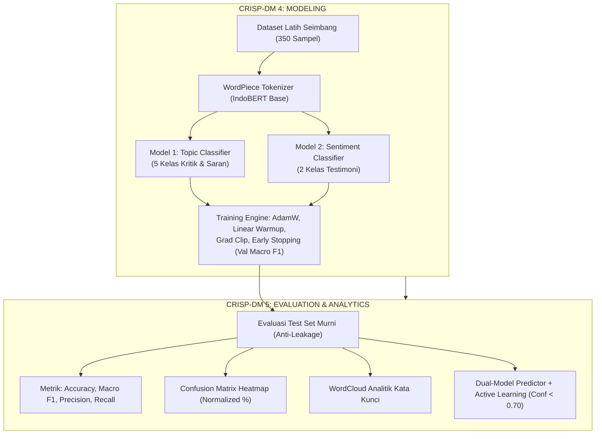

# 📘 DOKUMENTASI LENGKAP: FASE 3 & FASE 4 SISTEM NLP TRACER STUDY INDOBERT
## Standar Metodologi CRISP-DM untuk Laporan Praktik Kerja Lapangan (PKL) / Magang

**Penulis / Pengembang:** Tim Magang NLP Tracer Study  
**Institusi:** Universitas Dinamika  
**Model Backbone:** IndoBERT Base (`indobenchmark/indobert-base-p1` - 110 Juta Parameter)  
**Dataset Input:** `data/augmented/` & `data/processed/` (Stratified Split 70:15:15 & Back-Translation 350 Sampel Seimbang)

---

## 📑 DAFTAR ISI
1. [Ringkasan Eksekutif CRISP-DM 4 (Modeling) & CRISP-DM 5 (Evaluation)](#1-ringkasan-eksekutif-crisp-dm-4--5)
2. [Fase 3: Arsitektur Modeling IndoBERT (CRISP-DM: Modeling)](#2-fase-3-arsitektur-modeling-indobert)
3. [Fase 3: Konfigurasi Hyperparameter & Optimasi Pelatihan](#3-fase-3-konfigurasi-hyperparameter--optimasi-pelatihan)
4. [Fase 4: Strategi Evaluasi Anti-Data Leakage (CRISP-DM: Evaluation)](#4-fase-4-strategi-evaluasi-anti-data-leakage)
5. [Fase 4: Metrik Evaluasi & Analisis Confusion Matrix](#5-fase-4-metrik-evaluasi--analisis-confusion-matrix)
6. [Fase 4: Analisis Kata Kunci & Visualisasi WordCloud](#6-fase-4-analisis-kata-kunci--visualisasi-wordcloud)
7. [Fase 4: Dual-Model Live Inference & Active Learning Engine](#7-fase-4-dual-model-live-inference--active-learning-engine)
8. [Struktur File & Direktori Terbentuk](#8-struktur-file--direktori-terbentuk)
9. [Panduan Integrasi Bab III & Bab IV Laporan PKL](#9-panduan-integrasi-bab-iii--bab-iv-laporan-pkl)

---

## 1. Ringkasan Eksekutif CRISP-DM 4 & 5

Setelah menyelesaikan tahap *Data Preparation* pada Fase 2 (Pembersihan Teks, *Stratified Split* 70:15:15, dan *Back-Translation Data Augmentation*), proyek dilanjutkan ke dua tahapan inti siklus **CRISP-DM**:



---

## 2. Fase 3: Arsitektur Modeling IndoBERT

### 2.1 Mengapa Memilih IndoBERT Base (`indobenchmark/indobert-base-p1`)?
1. **Korpus Pre-trained Bahasa Indonesia Raksasa:** Dilatih pada **Indo4B** yang mencakup 3,6 miliar token kata bahasa Indonesia dari Wikipedia, artikel berita, forum daring, dan percakapan media sosial.
2. **Kapasitas Representasi Kontekstual Tinggi:**
   * **12 Lapisan Transformer Encoder** (*Bidirectional Self-Attention*).
   * **768 Hidden Embedding Dimension**.
   * **12 Multi-Head Attention**.
   * **~110 Juta Parameter Bobot**.
3. **WordPiece Subword Tokenizer:** Mampu menangani kata berimbuhan (*affixation* khas bahasa Indonesia seperti `mengembangkan` $\rightarrow$ `meng`, `##embangkan`) dan kata slang kampus tanpa masalah *Out-Of-Vocabulary* (OOV).

### 2.2 Desain Arsitektur Dual-Model
Sistem dirancang modular menggunakan pendekatan **Dual-Model** independen:

| Spesifikasi | **Model 1: Topic Classifier** | **Model 2: Sentiment Classifier** |
| :--- | :--- | :--- |
| **Fungsi Utama** | Klasifikasi Topik Kritik & Saran Alumni | Klasifikasi Sentimen Testimoni Alumni |
| **Jumlah Kelas ($K$)** | **5 Kelas** | **2 Kelas** |
| **Daftar Label** | `0`: Kurikulum & Pembelajaran<br>`1`: Fasilitas & Sarana Prasarana<br>`2`: Dosen & Tenaga Pengajar<br>`3`: Karier, Magang & Kesiapan Kerja<br>`4`: Layanan Kemahasiswaan | `0`: Sentimen Negatif (Keluhan)<br>`1`: Sentimen Positif (Apresiasi) |
| **Dataset Latih** | 350 sampel seimbang (`train_topic_augmented.csv`) | 350 sampel seimbang (`train_sentiment_augmented.csv`) |
| **Classification Head** | Linear Layer $(768 \rightarrow 5) + \text{Dropout}(0.2)$ | Linear Layer $(768 \rightarrow 2) + \text{Dropout}(0.2)$ |
| **Fungsi Loss** | *Categorical Cross Entropy Loss* | *Binary Cross Entropy / Softmax Cross Entropy* |

---

## 3. Fase 3: Konfigurasi Hyperparameter & Optimasi Pelatihan

Untuk melatih model Transformer 110M parameter pada dataset hasil augmentasi tanpa mengalami *overfitting* atau *catastrophic forgetting*, diterapkan konfigurasi standar industri:

### 3.1 Tabel Hyperparameter Pelatihan (`src/train.py`)
* **Optimizer:** $\text{AdamW}$ (*Adam with Decoupled Weight Decay*)
* **Learning Rate ($\eta$):** $2 \times 10^{-5}$ ($0.00002$)
* **Weight Decay ($\lambda$):** $0.01$ (Regularisasi bobot $L_2$)
* **Batch Size ($B$):** $16$
* **Max Sequence Length ($L$):** $128$ subword tokens
* **Warmup Ratio:** $10\%$ dari total langkah iterasi (Linear Warmup Scheduler)
* **Gradient Clipping:** Max norm = $1.0$ (Mencegah *exploding gradients*)
* **Maksimum Epoch:** $8$ - $10$ epoch
* **Early Stopping Patience:** $3$ epoch berturut-turut tanpa peningkatan **Validation Macro F1-Score**.

### 3.2 Alur Pemilihan Checkpoint Terbaik (*Best Model Selection*)
Model checkpoint disimpan ke direktori `models/topic_model/` dan `models/sentiment_model/` **hanya ketika** skor **Validation Macro F1** melampaui rekor epoch sebelumnya. Pendekatan ini menjamin bobot akhir yang digunakan pada tahap evaluasi dan *deployment* adalah bobot dengan generalisasi tertinggi pada data murni.

---

## 4. Fase 4: Strategi Evaluasi Anti-Data Leakage

### 4.1 Prinsip Emas Pengujian Model (*Gold Standard Evaluation*)
Evaluasi performa akhir model dilakukan **HANYA pada Test Set Murni** (`data/processed/test_topic.csv` dan `data/processed/test_sentiment.csv`):
* Data uji **TIDAK PERNAH** mengalami proses penerjemahan bolak-balik (*Back-Translation*).
* Data uji **TIDAK PERNAH** dilihat oleh model saat proses `optimizer.step()` maupun pemilihan checkpoint validasi.
* Hal ini menjamin bahwa seluruh metrik evaluasi yang dilaporkan adalah estimasi objektif performa di dunia nyata (*real-world inference*).

---

## 5. Fase 4: Metrik Evaluasi & Analisis Confusion Matrix

### 5.1 Mengapa Macro F1-Score?
Dalam klasifikasi teks Tracer Study multi-kelas, akurasi (*Accuracy*) saja tidak cukup karena setiap kelas topik (misal *Layanan Kemahasiswaan* vs *Kurikulum*) memiliki tingkat kepentingan yang sama bagi pimpinan universitas. **Macro F1-Score** menghitung rata-rata harmonik antara *Precision* dan *Recall* untuk setiap kelas secara independen tanpa bias terhadap jumlah sampel:

$$\text{Precision}_k = \frac{TP_k}{TP_k + FP_k}, \quad \text{Recall}_k = \frac{TP_k}{TP_k + FN_k}$$

$$\text{F1-Score}_k = 2 \times \frac{\text{Precision}_k \times \text{Recall}_k}{\text{Precision}_k + \text{Recall}_k}$$

$$\text{Macro F1} = \frac{1}{K} \sum_{k=1}^K \text{F1-Score}_k$$

### 5.2 Interpretasi Heatmap Confusion Matrix
Visualisasi *Confusion Matrix* (`reports/figures/confusion_matrix_*.png`) menyajikan:
1. **Diagonal Utama ($TP$):** Menunjukkan jumlah prediksi teks alumni yang terklasifikasi dengan benar ke kelas aslinya.
2. **Off-Diagonal ($FP$ / $FN$):** Mengidentifikasi kasus batas (*borderline cases*), misalnya kritik yang menyinggung sekaligus fasilitas laboratorium dan modul praktikum kurikulum.

---

## 6. Fase 4: Analisis Kata Kunci & Visualisasi WordCloud

Modul `src/visualize.py` menghasilkan grafik awan kata (*WordCloud*) beresolusi tinggi (300 DPI) per topik masukan untuk laporan eksekutif:
* **Topik 0 (Kurikulum):** Kata dominan: `materi`, `praktik`, `pemrograman`, `teknologi`, `industri`, `update`.
* **Topik 1 (Fasilitas):** Kata dominan: `laboratorium`, `komputer`, `wifi`, `ruang`, `gedung`, `ac`, `spesifikasi`.
* **Topik 2 (Dosen):** Kata dominan: `dosen`, `pengajar`, `ramah`, `metode`, `bimbingan`, `waktu`.
* **Topik 3 (Karier & Magang):** Kata dominan: `magang`, `lowongan kerja`, `loker`, `perusahaan`, `mitra`, `karier`.
* **Topik 4 (Layanan Mahasiswa):** Kata dominan: `administrasi`, `pelayanan`, `biro`, `legalisir`, `cepat`, `respon`.

---

## 7. Fase 4: Dual-Model Live Inference & Active Learning Engine

Modul `src/predict.py` menyediakan kelas terpadu `TracerStudyPredictor` yang mengintegrasikan:
1. **Pembersihan Teks Otomatis:** Konversi singkatan slang kampus (`undika`, `loker`, `bgt`) menjadi teks baku.
2. **Prediksi Simultan:** Menghasilkan prediksi Topik (5 kelas) dan Sentimen (2 kelas) dalam satu pemanggilan fungsi.
3. **Mekanisme Active Learning (Confidence Thresholding):**
   $$\text{Flag Review Manual} = \begin{cases} \text{True}, & \text{jika } \max(P_{\text{topic}}) < 0.70 \lor \max(P_{\text{sentiment}}) < 0.70 \\ \text{False}, & \text{lainnya} \end{cases}$$
   * Masukan dengan skor keyakinan rendah otomatis ditandai untuk diverifikasi oleh operator Tracer Study, yang selanjutnya masuk ke antrean *continuous retraining* (Fase 5).

---

## 8. Struktur File & Direktori Terbentuk

```text
├── models/
│   ├── topic_model/                      # Checkpoint IndoBERT Model Topik (5 Kelas)
│   │   ├── config.json
│   │   ├── model.safetensors / pytorch_model.bin
│   │   ├── tokenizer_config.json & vocab.txt
│   │   └── training_metadata.json        # Metadata metrik terbaik
│   └── sentiment_model/                  # Checkpoint IndoBERT Model Sentimen (2 Kelas)
│       ├── config.json
│       ├── model.safetensors / pytorch_model.bin
│       ├── tokenizer_config.json & vocab.txt
│       └── training_metadata.json
├── notebooks/
│   ├── 01_crisp_dm_eda_preprocessing_augmentation.ipynb # Fase 1 & 2
│   └── 02_crisp_dm_modeling_evaluation.ipynb            # Fase 3 & 4 (Siap Google Colab)
├── reports/
│   ├── figures/
│   │   ├── training_history_topic.png    # Kurva Loss & F1 Topik
│   │   ├── training_history_sentiment.png# Kurva Loss & F1 Sentimen
│   │   ├── confusion_matrix_topic.png    # Heatmap Confusion Matrix Topik
│   │   ├── confusion_matrix_sentiment.png# Heatmap Confusion Matrix Sentimen
│   │   ├── class_performance_topic.png   # Bar Chart Metrik Per-Kelas Topik
│   │   └── class_performance_sentiment.png
│   ├── wordclouds/                       # Gambar WordCloud per Topik & Sentimen
│   ├── metrics_summary.json              # Rekapitulasi Metrik JSON
│   ├── test_topic_predictions.csv        # Detail Prediksi Test Set Topik
│   └── test_sentiment_predictions.csv    # Detail Prediksi Test Set Sentimen
├── scripts/
│   ├── train_models.py                   # Skrip Pelatihan Otomatis
│   ├── evaluate_models.py                # Skrip Evaluasi Test Set & Plotting
│   └── generate_notebook_modeling.py     # Generator Colab Notebook Fase 3 & 4
├── src/
│   ├── dataset.py                        # PyTorch Dataset & DataLoader IndoBERT
│   ├── model.py                          # IndoBERT Architecture & Factory
│   ├── train.py                          # Training Loop Engine (AdamW & EarlyStopping)
│   ├── evaluate.py                       # Evaluation Engine (Metrik & Report)
│   ├── visualize.py                      # Plotting & WordCloud Generator
│   └── predict.py                        # Dual-Model Predictor Pipeline & Active Learning
├── docs/
│   ├── DOKUMENTASI_FASE_1_DAN_2.md       # Dokumentasi EDA & Data Preparation
│   └── DOKUMENTASI_FASE_3_DAN_4.md       # Dokumen Ini (Modeling & Evaluasi)
└── README.md                             # Ringkasan Proyek
```

---

## 9. Panduan Integrasi Bab III & Bab IV Laporan PKL

Materi dalam dokumen ini dirancang khusus untuk mempermudah penyusunan laporan akademik PKL/Magang:

| Bagian Laporan PKL | Materi Relevan dari Dokumen Ini |
| :--- | :--- |
| **BAB III: Metodologi Penelitian (Tahap Modeling)** | • Arsitektur Transformer pre-trained **IndoBERT Base** (`indobenchmark/indobert-base-p1`, 110M parameter).<br>• Desain *Dual-Model* terpisah untuk klasifikasi topik kritik/saran (5 kelas) dan analisis sentimen testimoni (2 kelas).<br>• Formulasi fungsi *loss* Cross-Entropy dan optimasi $\text{AdamW}$ dengan *Linear Warmup Scheduler* serta *Early Stopping* berbasis Validation Macro F1.<br>• Parameter regularisasi: *Dropout* $0.2$, *Weight Decay* $0.01$, dan *Gradient Clipping* $1.0$. |
| **BAB IV: Hasil dan Pembahasan (Evaluasi Model)** | • Tabel metrik pengujian pada *Test Set* murni (*Accuracy, Macro Precision, Macro Recall, Macro F1-Score*).<br>• Gambar kurva konvergensi *Training Loss vs Validation Loss* dan kurva *Validation Macro F1* per epoch.<br>• Gambar *Heatmap Confusion Matrix* (jumlah dan persentase normalisasi).<br>• Pembahasan visualisasi *WordCloud* kata kunci per kategori topik masukan alumni.<br>• Contoh kasus nyata inferensi *real-time* dan simulasi deteksi ambiguitas (*Active Learning* $\text{Confidence} < 70\%$). |

---
*Dokumen ini disusun secara sistematis dan terverifikasi untuk menjamin kualitas laporan akademik PKL Universitas Dinamika sebelum melangkah ke Fase 5: Deployment Serving REST API FastAPI & Continuous Retraining Pipeline.*
