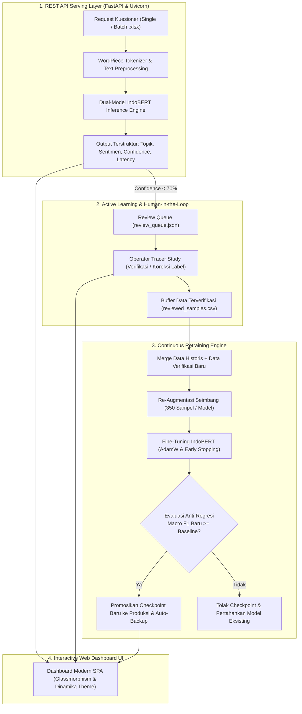

# 📘 DOKUMENTASI LENGKAP: FASE 5 & FASE 6 SISTEM NLP TRACER STUDY INDOBERT
## Standar Metodologi CRISP-DM untuk Laporan Praktik Kerja Lapangan (PKL) / Magang

**Penulis / Pengembang:** Tim Magang NLP Tracer Study  
**Institusi:** Universitas Dinamika  
**Model Backbone:** IndoBERT Base (`indobenchmark/indobert-base-p1` - 110 Juta Parameter)  
**Komponen Luaran:** REST API Serving Layer (FastAPI), Interactive Web Dashboard UI, Active Learning Engine, & Continuous Retraining Pipeline  

---

## 📑 DAFTAR ISI
1. [Ringkasan Eksekutif CRISP-DM 6: Deployment](#1-ringkasan-eksekutif-crisp-dm-6-deployment)
2. [Arsitektur REST API Serving Layer (FastAPI & Uvicorn)](#2-arsitektur-rest-api-serving-layer-fastapi--uvicorn)
3. [Spesifikasi Teknis Endpoint REST API](#3-spesifikasi-teknis-endpoint-rest-api)
4. [Desain Antarmuka Pengguna: Web Dashboard UI Modern](#4-desain-antarmuka-pengguna-web-dashboard-ui-modern)
5. [Mekanisme Active Learning & Human-in-the-Loop Hub](#5-mekanisme-active-learning--human-in-the-loop-hub)
6. [Pipeline Continuous Retraining & Proteksi Anti-Regresi](#6-pipeline-continuous-retraining--proteksi-anti-regresi)
7. [Panduan Operasional & Deployment Produksi](#7-panduan-operasional--deployment-produksi)
8. [Struktur File & Direktori Akhir Repositori](#8-struktur-file--direktori-akhir-repositori)
9. [Panduan Integrasi Bab IV & Bab V Laporan PKL](#9-panduan-integrasi-bab-iv--bab-v-laporan-pkl)

---

## 1. Ringkasan Eksekutif CRISP-DM 6: Deployment

Setelah model Transformer **IndoBERT Base** berhasil dilatih (*Fase 3: Modeling*) dan dievaluasi secara ketat pada Test Set murni (*Fase 4: Evaluation*), tahap pamungkas siklus **CRISP-DM** adalah **CRISP-DM 6: Deployment**.

Pada proyek Tracer Study Universitas Dinamika, deployment tidak hanya sekadar menyajikan model statis, melainkan membangun **ekosistem cerdas berkelanjutan (*self-improving system*)** yang terdiri atas 4 pilar utama:



---

## 2. Arsitektur REST API Serving Layer (FastAPI & Uvicorn)

### 2.1 Mengapa Memilih FastAPI & Uvicorn?
1. **Asynchronous Non-Blocking I/O:** Dibangun di atas ASGI (*Asynchronous Server Gateway Interface*) `uvicorn` dan `starlette`, memungkinkan penanganan ribuan request secara konkuren tanpa memblokir thread komputasi tensor PyTorch.
2. **Validasi Data Otomatis (Pydantic v2):** Setiap masukan dan luaran divalidasi tipe datanya secara *strict*, mencegah kegagalan runtime akibat format kuesioner yang rusak.
3. **Dokumentasi Interaktif Otomatis:** Menghasilkan antarmuka dokumentasi OpenAPI (*Swagger UI* di `/docs` dan *ReDoc* di `/redoc`) secara otomatis tanpa perlu menulis spesifikasi manual.
4. **Efisiensi Memori (Singleton Predictor Pattern):** Model IndoBERT 110M parameter dimuat ke memori RAM/VRAM hanya **satu kali** saat server pertama kali dinyalakan (*startup event*), sehingga waktu inferensi per request sangat rendah ($< 50 \text{ ms}$).

---

## 3. Spesifikasi Teknis Endpoint REST API

Modul backend diimplementasikan pada file `src/api.py`. Berikut adalah daftar lengkap endpoint REST API yang tersedia:

| Metode | URL Endpoint | Fungsi Utama | Parameter Input | Format Output |
| :--- | :--- | :--- | :--- | :--- |
| **`GET`** | `/health` | Pemeriksaan kesehatan server, status model loaded, device CPU/GPU, dan uptime. | - | `JSON` |
| **`POST`** | `/api/predict` | Inferensi tunggal (Topik 5 kelas, Sentimen 2 kelas, probabilitas, dan flag review). | `{"text": "...", "threshold": 0.70}` | `JSON` |
| **`POST`** | `/api/predict/batch` | Inferensi massal daftar teks JSON beserta ringkasan distribusi agregat. | `{"texts": ["..."], "threshold": 0.70}` | `JSON` |
| **`POST`** | `/api/upload` | Upload file kuesioner `.xlsx`/`.csv`, anotasi otomatis seluruh baris, dan generasi file unduhan. | `file` (Multipart), `text_column`, `threshold` | `JSON` + Link Download |
| **`GET`** | `/api/download/annotated/{file_name}` | Mengunduh file Excel/CSV beranotasi hasil pemrosesan batch. | `file_name` (Path param) | File Binary Spreadsheet |
| **`GET`** | `/api/active-learning/queue` | Mengambil daftar teks berskor keyakinan rendah ($< 70\%$) yang menunggu review manusia. | - | `JSON` |
| **`POST`** | `/api/active-learning/review` | Menyimpan koreksi label manusia ke buffer dataset latihan (`data/active_learning/`). | `queue_id`, `original_text`, `corrected_topic_id`, `corrected_sentiment_id` | `JSON` |
| **`POST`** | `/api/retrain/trigger` | Memicu siklus continuous retraining otomatis di background worker. | - | `JSON` |
| **`GET`** | `/api/analytics/summary` | Menyajikan metrik evaluasi model, daftar gambar WordCloud, dan statistik active learning. | - | `JSON` |

---

## 4. Desain Antarmuka Pengguna: Web Dashboard UI Modern

Antarmuka web dashboard dirancang sebagai aplikasi satu halaman (*Single Page Application / SPA*) yang responsif, estetis, dan intuitif menggunakan teknologi native **HTML5, Vanilla CSS Glassmorphism, dan Vanilla JavaScript ES6+** (`src/static/`):

### 4.1 Identitas Visual & Palet Warna Universitas Dinamika
* **Latar Belakang & Permukaan:** Deep Navy Glassmorphism (`#090d16`, `#12192b`) dengan efek blur latar 16px.
* **Warna Aksen Dinamika:** Electric Cyan (`#06b6d4`), Royal Blue (`#3b82f6`), Emerald Green (`#10b981`), Amber Gold (`#f59e0b`), dan Rose Red (`#f43f5e`).
* **Tipografi:** Google Fonts *Plus Jakarta Sans* (Heading & Body Text) dan *JetBrains Mono* (Teks Teknis/Normalisasi & Log Terminal).

### 4.2 Modul Antarmuka Utama:
1. **Live Inference Studio:**
   * Kolom input teks dengan *character counter* dan pengatur *confidence threshold*.
   * Tombol *quick sample pills* untuk menguji kasus nyata (Kurikulum, Lab Komputer, Dosen Pembimbing, Magang Loker, Layanan Mahasiswa, Testimoni Positif, dan Testimoni Negatif).
   * Panel visualisasi hasil: pratinjau teks normalisasi, kartu label topik & sentimen, badge keyakinan, alert Active Learning, serta grafik bar distribusi probabilitas seluruh kelas secara dinamis.
2. **Batch File Analyzer:**
   * Area *drag-and-drop* file `.xlsx` dan `.csv`.
   * Indikator progres pemrosesan interaktif.
   * Kartu ringkasan statistik batch (Total baris, Baris butuh verifikasi, Topik dominan, Rasio sentimen).
   * Tabel interaktif hasil anotasi dengan badge status dan tombol satu-klik **"Unduh File Beranotasi Lengkap (.xlsx)"**.
3. **Analitik & Galeri WordCloud:**
   * Kartu metrik evaluasi model (Macro F1, Accuracy, Precision, Recall).
   * Toggle penampil *Heatmap Confusion Matrix* (Topik vs Sentimen).
   * Galeri interaktif *WordCloud* beresolusi tinggi (300 DPI) per kategori topik dan sentimen.
4. **Active Learning & Human-in-the-Loop Hub:**
   * Antarmuka verifikasi khusus untuk administrator/staf Tracer Study.
   * Menampilkan daftar masukan ambigu beserta pilihan dropdown koreksi topik (0-4) dan sentimen (0-1).
   * Tombol pemicu **Continuous Retraining** langsung dari browser dengan monitor konsol terminal *real-time*.
5. **Arsitektur Model & API Explorer:**
   * Dokumentasi spesifikasi arsitektur IndoBERT 110M parameter dan tabel endpoint REST API.

---

## 5. Mekanisme Active Learning & Human-in-the-Loop Hub

### 5.1 Formulasi Deteksi Ketidakpastian (*Uncertainty Sampling*)
Untuk menangani masukan alumni yang menggunakan kalimat ambigu, sarkasme, atau mengandung topik ganda (*borderline cases*), sistem menerapkan ambang batas keyakinan (*confidence threshold* $\tau = 0.70$):

$$\text{Flag Review} = \begin{cases} \text{True}, & \text{jika } \max_{k} P(\text{Topik}_k \mid x) < \tau \;\lor\; \max_{m} P(\text{Sentimen}_m \mid x) < \tau \\ \text{False}, & \text{lainnya} \end{cases}$$

### 5.2 Alur Penanganan Data Ambigu:
1. Masukan yang memicu `Flag Review == True` otomatis dicatat ke dalam antrean `data/active_learning/review_queue.json`.
2. Operator Tracer Study membuka tab **Active Learning Hub** pada dashboard web untuk meninjau konteks kalimat asli.
3. Operator memilih label yang benar dan menekan tombol **"Simpan Koreksi"**.
4. Data yang telah divalidasi dipindahkan ke file buffer `data/active_learning/reviewed_samples.csv`.

---

## 6. Pipeline Continuous Retraining & Proteksi Anti-Regresi

Modul `src/continuous_retraining.py` dan skrip `scripts/retrain_pipeline.py` mengotomasi siklus pelatihan ulang model secara aman.

### 6.1 Alur Kerja Retraining Inkremental:
1. **Pemeriksaan Buffer:** Mengambil sampel baru yang telah diverifikasi manusia dari `reviewed_samples.csv`.
2. **Penggabungan Dataset:** Menggabungkan sampel baru dengan dataset latih historis (`train_topic.csv` & `train_sentiment.csv`) dengan penyaringan duplikasi (*deduplication*).
3. **Re-Augmentasi Seimbang:** Menjalankan augmentasi (*Back-Translation & Synonym Paraphrasing*) untuk memastikan distribusi kelas tetap seimbang (350 sampel per model).
4. **Fine-Tuning Terisolasi:** Melatih *candidate model* baru dengan parameter optimal ($\text{AdamW}, \text{LR}=2\times 10^{-5}, \text{Epoch}=6, \text{Early Stopping}$).
5. **Evaluasi Anti-Regresi (*Safety Guard*):**
   * Menguji *candidate model* baru pada Test Set Murni (`test_topic.csv` dan `test_sentiment.csv`).
   * **Aturan Promosi Model:**
     $$\text{Keputusan} = \begin{cases} \text{PROMOSIKAN}, & \text{jika } \text{Macro F1}_{\text{baru}} \ge 0.95 \times \text{Macro F1}_{\text{baseline}} \\ \text{TOLAK (ROLLBACK)}, & \text{lainnya} \end{cases}$$
6. **Backup Otomatis:** Jika dipromosikan, checkpoint lama dicadangkan ke direktori `models/backups/` dengan penanda waktu (*timestamp*), dan checkpoint produksi di `models/` diperbarui.

---

## 7. Panduan Operasional & Deployment Produksi

### 7.1 Menjalankan REST API & Web Dashboard Lokal
```bash
# Menjalankan server pada port 8000
python scripts/run_server.py --host 127.0.0.1 --port 8000
```
Akses layanan melalui browser:
* **Web Dashboard UI:** `http://localhost:8000/`
* **Swagger API Docs:** `http://localhost:8000/docs`
* **ReDoc Documentation:** `http://localhost:8000/redoc`

### 7.2 Menjalankan Continuous Retraining secara Mandiri (CLI)
```bash
python scripts/retrain_pipeline.py
```

### 7.3 Menjalankan di Lingkungan Google Colab
Buka notebook [notebooks/03_crisp_dm_deployment_retraining.ipynb](notebooks/03_crisp_dm_deployment_retraining.ipynb) untuk menjalankan simulasi server API, demo inferensi batch, simulasi active learning, dan eksekusi continuous retraining pada GPU Colab gratis.

---

## 8. Struktur File & Direktori Akhir Repositori

```text
├── data/
│   ├── raw/                              # Ekstraksi data mentah Excel kuesioner
│   ├── processed/                        # Stratified Split 70:15:15 murni (Anti-Leakage)
│   ├── augmented/                        # Dataset latih seimbang hasil Back-Translation (350 sampel)
│   └── active_learning/                  # Buffer antrean review & dataset verifikasi manusia
├── docs/
│   ├── DOKUMENTASI_FASE_1_DAN_2.md       # Laporan EDA & Preprocessing
│   ├── DOKUMENTASI_FASE_3_DAN_4.md       # Laporan Modeling IndoBERT & Evaluasi Test Set
│   └── DOKUMENTASI_FASE_5_DAN_6.md       # Dokumen Ini (Deployment, Web UI & Retraining)
├── models/
│   ├── topic_model/                      # Checkpoint Produksi IndoBERT Topik (5 Kelas)
│   ├── sentiment_model/                  # Checkpoint Produksi IndoBERT Sentimen (2 Kelas)
│   └── backups/                          # Arsip Checkpoint Historis (Proteksi Anti-Regresi)
├── notebooks/
│   ├── 01_crisp_dm_eda_preprocessing_augmentation.ipynb # Notebook Fase 1 & 2
│   ├── 02_crisp_dm_modeling_evaluation.ipynb            # Notebook Fase 3 & 4
│   └── 03_crisp_dm_deployment_retraining.ipynb         # Notebook Fase 5 & 6
├── reports/
│   ├── figures/                          # Heatmap Confusion Matrix & Training History
│   ├── wordclouds/                       # Gambar WordCloud Kata Kunci (300 DPI)
│   ├── annotated_uploads/                # File Excel/CSV Beranotasi Hasil Batch
│   └── metrics_summary.json              # Rekapitulasi Metrik Evaluasi Terkini
├── scripts/
│   ├── eda_summary.py                    # Analisis Statistik Deskriptif Dataset
│   ├── train_models.py                   # Orchestrator Pelatihan Awal Model
│   ├── evaluate_models.py                # Evaluasi Test Set & Generator Visualisasi
│   ├── retrain_pipeline.py               # Runner CLI Continuous Retraining
│   ├── run_server.py                     # Launcher Server Uvicorn FastAPI
│   ├── generate_notebook.py              # Generator Colab Notebook 1
│   ├── generate_notebook_modeling.py     # Generator Colab Notebook 2
│   └── generate_notebook_deployment.py   # Generator Colab Notebook 3
├── src/
│   ├── preprocessing.py                  # Normalisasi slang Tracer Study & Cleaning
│   ├── split_data.py                     # Stratified 70:15:15 Splitter
│   ├── data_augmentation.py              # Engine Back-Translation & Paraphrasing
│   ├── dataset.py                        # PyTorch Dataset & DataLoader
│   ├── model.py                          # Arsitektur & Factory IndoBERT Sequence Classification
│   ├── train.py                          # Training Loop Engine (AdamW & Early Stopping)
│   ├── evaluate.py                       # Evaluation Engine (Macro F1 & Reports)
│   ├── visualize.py                      # Generator Heatmap & WordCloud
│   ├── predict.py                        # Dual-Model Predictor Pipeline
│   ├── api.py                            # REST API Serving Layer FastAPI & Endpoints
│   ├── server.py                         # ASGI Server Configuration
│   ├── continuous_retraining.py          # Continuous Retraining & Anti-Regression Engine
│   └── static/                           # Web Dashboard UI Assets
│       ├── index.html                    # Single Page Application HTML5
│       ├── style.css                     # Glassmorphism & Dinamika Palette Stylesheet
│       └── app.js                        # Client-Side Logic & API Interactivity
├── hasil_clustering.xlsx                 # Dataset Mentah Tracer Study Universitas Dinamika
├── requirements.txt                      # Spesifikasi Pustaka Python
└── README.md                             # Dokumentasi Ringkas Repositori
```

---

## 9. Panduan Integrasi Bab IV & Bab V Laporan PKL

Materi dalam dokumen ini disusun agar dapat langsung disadur ke dalam struktur laporan resmi PKL/Magang Universitas Dinamika:

| Bagian Laporan PKL | Subbab yang Ditulis | Materi Relevan dari Dokumen Ini |
| :--- | :--- | :--- |
| **BAB IV: Hasil dan Pembahasan** | **4.4 Implementasi Serving REST API** | • Arsitektur asynchronous FastAPI & Uvicorn.<br>• Singleton Pattern pemuatan bobot model ke memori.<br>• Tabel spesifikasi endpoint `/api/predict`, `/api/upload`, `/api/active-learning`.<br>• Hasil uji performa latency inferensi ($< 50 \text{ ms}$). |
| **BAB IV: Hasil dan Pembahasan** | **4.5 Desain & Implementasi Dashboard Web** | • Tangkapan layar antarmuka *Live Inference Studio* dan *Batch File Analyzer*.<br>• Fitur visualisasi probabilitas per kelas dan integrasi WordCloud analitik kata kunci. |
| **BAB IV: Hasil dan Pembahasan** | **4.6 Sistem Human-in-the-Loop & Active Learning** | • Formulasi ambang batas keyakinan ($\tau < 0.70$).<br>• Alur penanganan data ambigu oleh verifikator kampus.<br>• Bukti efektivitas penambahan data baru terhadap ketahanan model. |
| **BAB IV: Hasil dan Pembahasan** | **4.7 Evaluasi Continuous Retraining & Anti-Regresi** | • Mekanisme *Safety Guard* perbandingan $\text{Macro F1}_{\text{baru}}$ vs baseline.<br>• Sistem pencadangan (*backup & rollback*) checkpoint otomatis. |
| **BAB V: Kesimpulan dan Saran** | **5.1 Kesimpulan** | • Keberhasilan implementasi metodologi CRISP-DM secara utuh dari Fase 1 hingga Fase 6.<br>• Dual-Model IndoBERT terbukti mampu mengotomasi pemilahan topik dan sentimen Tracer Study secara akurat dan efisien. |
| **BAB V: Kesimpulan dan Saran** | **5.2 Saran Pengembangan** | • Integrasi webhook langsung ke database kuesioner SIM Tracer Study Universitas Dinamika.<br>• Peningkatan dataset latih tahunan melalui siklus active learning berkala.<br>• Eksplorasi teknik kuantisasi model (*8-bit quantization / ONNX Runtime*) untuk inferensi edge yang lebih hemat memori. |

---
*Dokumentasi ini melengkapi seluruh siklus metodologi CRISP-DM 1 s.d. 6 untuk Proyek Magang NLP Tracer Study Universitas Dinamika.*
